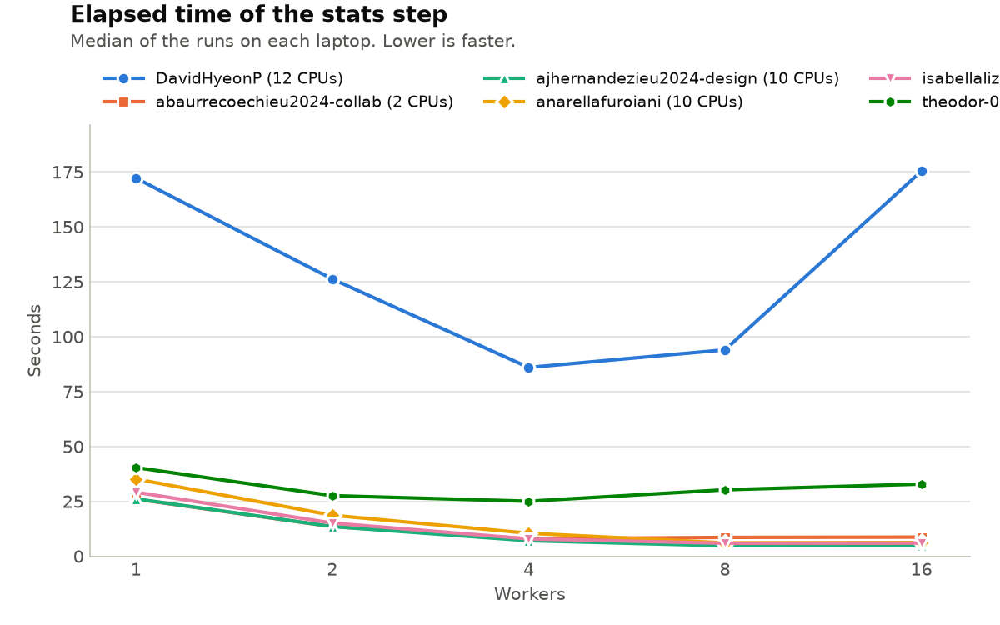

# Lab 1: The Nightly Report

Write your answers in this file. Keep them short: a few sentences, the commands
you used, and the numbers you measured. Copy the lines of output that matter,
not whole screens.

## Warm-up: Generating the report

- What happened, and why: The script did not have permission to run directly. However, using bash run_report.sh worked because Bash can read the file without that permission.
- Your fix, and how it reached your teammates: I used chmod +x run_report.sh to make the script executable. Then I committed the change and pushed it to GitHub so my teammates could get it using git pull.

## Task 1: Generating the report… again

- **Symptom:** The original `steps/report.py` exceeded the 2 GiB Docker memory limit and was killed (OOM, exit status 137).

- **Commands and recordings:** We tested the original script on 1, 2 and 4 million orders to investigate memory growth. We measured the optimized script using `/usr/bin/time -v python3 steps/report.py` and validated its output with `python3 tools/check.py`.

- **Cause:** The script loaded all 8.4 million orders into memory and created 12 monthly DataFrames followed by `pd.concat()`, causing excessive memory consumption.

- **Fix:** Replaced full-file loading with `pd.read_csv(DATA, chunksize=100_000)`. Each chunk is grouped by region and month, keeping only accumulated revenue totals.

- **Before and after (measurements):**
  - Before: OOM kill under the 2 GiB limit (exit status 137).
  - After: 8,400,000 orders processed successfully.
  - Elapsed time: 9.14 s.
  - User CPU time: 9.39 s.
  - System CPU time: 0.53 s.
  - Peak RSS: 207,600 KB (approximately 202.7 MiB).
  - Exit status: 0.
  - Validation: `PASS revenue_by_region_month.csv`.

**Conclusion:** Chunking reduced peak memory while preserving the expected output.

## Task 2: Extracting data

- **Symptom:**

The extraction script printed `extracts: done`, but all six regional CSV files were empty (0 rows). The script appeared to work even though no data was extracted.

- **Commands and recordings:**

1. `bash steps/extracts.sh` — We first ran the script to see whether it worked. It printed `extracts: done`, which suggested that the extraction had finished successfully.

2. `echo $?` — We checked the exit code of the script. It returned `0`, meaning the system reported no error. However, this did not prove that the output was correct, so we checked the files next.

3. `ls -l ~/data/out/extracts` — We inspected the files created by the script. All six regional CSV files had a size of 0 bytes. This showed that the script was creating files but not extracting any data.

4. `less steps/extracts.sh` — We read the original script to understand its commands. We noticed that it changed the working directory and used a relative path to find the dataset. We also saw that `2>/dev/null` was hiding error messages.

5. `grep ",Iberia," ../data/sales_2025.csv | cut -d, -f1,2,4,6,7 | wc -l` — We tested the extraction pipeline manually using Iberia as an example. `grep` searches for Iberia orders. Instead of finding records, we received `No such file or directory` and a count of 0. This suggested that the input path was incorrect.

6. `echo ${PIPESTATUS[@]}` — We checked the exit code of each command in the pipeline. The result was `2 0 0`, meaning `grep` failed, but `cut` and `wc` succeeded. This explained why the script could appear successful even when the extraction failed.

7. `pwd` — We checked our current working directory. It was `/home/analyst/data/out/extracts`, confirming that the relative path was being interpreted from the extraction folder rather than from the repository.

8. `grep -c ',Iberia,' ~/data/sales_2025_sample.csv` — We checked whether the dataset actually contained Iberia orders. It returned 25,928 records, confirming that the data existed and the problem was the incorrect file path.

- **Cause:**

The script used `cd "$OUT/extracts"` and then tried to read `../data/sales_2025.csv`. This relative path did not point to the dataset. Additionally, `2>/dev/null` hid the error messages, and the script did not detect failures in the pipeline.

- **Fix:**

We removed the unnecessary `cd` command and replaced the relative input path with the `DATA` environment variable, defaulting to `$HOME/data/sales_2025.csv`. We also removed `2>/dev/null` and added `set -euo pipefail` so that errors are visible and the script stops if a command fails.

- **Before and after (your measurements):**

| Measurement       | Before           | After                                   |
| ----------------- | ---------------- | --------------------------------------- |
| Sample dataset    | 0 rows extracted | 100,000 rows extracted                  |
| Full dataset      | 0 rows extracted | 8,400,000 rows extracted                |
| Iberia sample     | 0 rows           | 25,928 rows                             |
| Error detection   | Errors hidden    | Errors visible; script stops on failure |
| Output validation | Incorrect        | All six regional checks passed          |

After the fix, the script generated all six regional CSV files correctly. We verified the results using `wc -l` and `python3 tools/check.py`.

## Task 3: Auditing

- Symptom:
- Commands and recordings you used, why you chose them, and what they showed:
- Cause:
- Fix:
- Before and after (your measurements):

## Task 4: Segmenting the orders

- Symptom: The segments step was taking much longer than reading the CSV.
- Commands and recordings you used, why you chose them, and what they showed: I used /usr/bin/time to measure execution time and CPU usage, and cProfile to find the slow functions. The profiler showed 100,000 calls to strptime() on the sample.
- Cause: The script was converting dates one by one inside a loop, which wasted CPU time.
- Fix: I used pandas to calculate the quarters before the loop, instead of converting each date separately.
- Before and after (your measurements): On 100,000 rows, execution time dropped from 1.01 s to 0.29 s (about 71% less time). cProfile time dropped from 0.890 s to 0.402 s. The output was identical. The full dataset ran in 10.43 s with 1,265,744 KB peak memory.

## Task 5: Computing the statistics

- Symptom: stats.sh hardcodes 16 workers. With nproc=4, elapsed time does not improve beyond 2 workers. Ctrl-C leaves orphan python3 workers running.
- Commands: `nproc` (returned 4), `bash tools/sweep.sh Thedoor`, `ps -ef` after `kill %1`, `/usr/bin/time` on original and fixed versions.
- Cause: 16 workers on 4 CPUs means time-sharing overhead. Background children (`&`) are not killed when the parent exits.
- Fix: Changed `WORKERS=${WORKERS:-16}` to `WORKERS=${WORKERS:-$(nproc)}`. Added `trap 'kill 0' EXIT` to kill all children on exit.
- Before: 16 workers, ~38s elapsed, ~106s user, ~45s system. Orphans survive Ctrl-C.
- After: 4 workers, "done with 4 workers". No orphans after kill. Sweep shows 2 workers (~37s) is fastest.

## The worker experiment

Every member runs `tools/sweep.sh` on their own laptop. Then run
`python3 tools/plot_sweep.py` and commit `results/sweep.png`.

- How does the elapsed time change with the number of workers on each laptop?
- Why do the curves of your laptops differ? Use the cores and threads of each
  laptop, listed in `TEAM.md`.
- Which default number of workers did you choose for `stats.sh`, and why?

## Use of generative AI

Follow the format in the syllabus: quote any generated text and name the tool
and the prompts; add the same note as a comment before any generated code. If
you did not use GenAI, write: "No content generated by AI technologies has been
used in this assignment."

### AI use for Task 4

Tool: ChatGPT (OpenAI).

Prompts: I asked ChatGPT to guide me step by step through Task 4, help identify the slow part of segments.py using cProfile, suggest a simpler way to calculate quarters, compare execution times, and help write my findings.

Generated code:
`orders["quarter"] = pd.to_datetime(orders["order_date"]).dt.quarter`
`quarter = order.quarter`

Generated report text: The five bullet points under "Task 4: Segmenting the orders" were drafted with ChatGPT's assistance.

I ran the commands myself, checked the profiler results, and verified that the optimized output matched the original.

### AI use for Task 2
Tool: ChatGPT (OpenAI).
We used ChatGPT to help us understand and debug the problems in extracts.sh. It helped as a guide trough terminal commands and understanding new outputs. We also used it to review our solution and organize the explanation in the report. All commands were executed by us, and we checked the results using the sample and full datasets.

### AI Use — Task 1 

Tool: ChatGPT. Used it as a learning tool and for support. I asked for step by step guidance in the use of GitHub as I had limited experience with this tool, understanding the issues, guide through commands, drafting and testing. 

### AI use for Task 5
Tool: Claude (Anthropic)
Prompts: I asked to highlight the bugs in stats.sh and the necessary edits to remove the fix number of workers and deal with orphan processes. I also asked for help formatting this report section based on my answers and measurements and to correct my work / interpretation if necessary.
